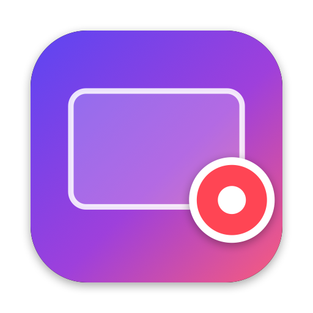

<p align="center">
  
</p>

<h1 align="center">Glance — free, open-source Loom alternative for macOS</h1>

<p align="center">
  <b>Record your screen, a webcam bubble, your microphone and system audio into one ready-to-share MP4.</b><br>
  Native Swift · SwiftUI · ScreenCaptureKit · AVFoundation · No account · No uploads · No dependencies
</p>

<p align="center">
  <a href="https://github.com/UtkarshCodecom/glance-screen-recorder/actions/workflows/ci.yml"></a>
  <a href="LICENSE"></a>
  
  
  
</p>

---

**Glance** is a native **macOS screen recorder with a webcam overlay**, built for quick async video:
walkthroughs, bug reports, code reviews, tutorials and product demos. Like Loom, it shows your face
in a circular camera bubble on top of your screen. Unlike Loom, it is **100% local and open source**.
Your recordings never leave your Mac, and there's nothing to sign up for.

It records the **screen, webcam, microphone and system audio at the same time**. It composites the
camera bubble into the video and mixes your voice with the computer's sound into **one audio track**,
so the MP4 is finished the moment you press stop. No editing required.

> **Project status:** early (v1.0). Screen, webcam bubble and microphone recording are verified on
> real hardware. System audio capture currently records silence on some setups.
> See [Known issues](#known-issues). Contributions are very welcome!

## Table of contents

- [Features](#features)
- [Requirements](#requirements)
- [Install / build from source](#install--build-from-source)
- [How to use](#how-to-use)
- [Keyboard shortcuts](#keyboard-shortcuts)
- [Glance vs. Loom](#glance-vs-loom)
- [How it works](#how-it-works)
- [Known issues](#known-issues)
- [FAQ](#faq)
- [Contributing](#contributing)
- [License](#license)

## Features

- 🎥 **Screen recording.** Record the full display or a single window, or pick content with the macOS system picker.
- 🙂 **Webcam bubble overlay.** Circle, rounded square or landscape. Drag it anywhere, resize it, mirror it, and set the
  border colour, width and shadow. The floating bubble follows your changes live while you record.
- 🎙️ **Microphone + system audio.** Captured together and mixed into a single AAC track, with a volume per source.
  Optionally keep separate tracks for editing.
- 📼 **One MP4, ready to share.** H.264 or HEVC, from 720p to native resolution (up to 4K), at 24/30/60 fps.
  The movie header goes at the front of the file ("fast start") for quick web playback.
- ⏯️ **Pause / resume.** Paused time is cut from the final video, with no frozen frames.
- ⏱️ **Countdown** (off/3/5/10 s), a **floating control bar** with timer and mic meter, and a **menu-bar recorder**.
- ⌨️ **Global shortcuts.** Start, stop and pause from any app, with no Accessibility permission needed.
- 📚 **Recordings library.** Thumbnails, duration and date. Play, rename, copy, share, reveal in Finder, move to Trash.
- 🛟 **Reliability.** Crash recovery for unfinished recordings, a low-disk-space guard, auto-pause on sleep,
  camera/mic hot-plug handling, and verification of every file before it's reported as saved.
- 🌗 **Native macOS design.** SwiftUI, light & dark mode, no Electron, no web views.

## Requirements

| | |
|---|---|
| macOS | **15.0 Sequoia or later** (ScreenCaptureKit microphone capture was added in 15.0) |
| Xcode | 16 or later (developed with Xcode 27 / macOS 27 SDK) |
| Hardware | Apple silicon or Intel Mac. A webcam and microphone are optional |

## Install / build from source

```bash
git clone https://github.com/UtkarshCodecom/glance-screen-recorder.git
cd glance-screen-recorder
open Glance.xcodeproj   # then press ⌘R
```

Or from the terminal:

```bash
xcodebuild -project Glance.xcodeproj -scheme Glance -configuration Debug -derivedDataPath build/DerivedData build
open build/DerivedData/Build/Products/Debug/Glance.app
```

Run the test suite (56 tests, including real AVFoundation encode/mix pipeline tests):

```bash
xcodebuild -project Glance.xcodeproj -scheme Glance -derivedDataPath build/DerivedData test
```

> If `xcodebuild` complains that the active developer directory is the Command Line Tools, run
> `sudo xcode-select -s /Applications/Xcode.app` once, or prefix commands with
> `DEVELOPER_DIR=/Applications/Xcode.app/Contents/Developer`.

### Signing and macOS permissions

The project signs ad-hoc ("Sign to Run Locally"), so anyone can build it without an Apple developer account.
macOS ties the Screen Recording, Camera and Microphone permissions to the app's code signature, so:

- **After each rebuild you may need to grant permissions again.** For a stable identity, select your team
  under *Signing & Capabilities*. A free Apple ID team works.
- **Keep only one copy of `Glance.app` on disk** (for example, don't keep a Release build next to a Debug build).
  Copies share the bundle ID, and System Settings can attach your grant to the wrong one. The system log then
  shows `Failed to match existing code requirement … kTCCServiceScreenCapture`. To recover, delete the extra copy, run
  `tccutil reset All dev.utkarsh.Glance`, relaunch Glance and allow access again.

## How to use

1. **Pick what to record.** *Full Screen*, *Window*, or *Choose with System Picker…*.
2. **Set up the camera bubble.** Drag it on the live preview, then choose its shape, size and mirroring.
3. **Choose audio.** Microphone (with live level meter) and/or system audio, each with its own volume.
4. **Press Start Recording** (⌘↩, or ⌥⇧⌘R from anywhere). After the countdown, the main window hides and a
   floating control bar appears.
5. **Press stop.** Glance finalizes and verifies the MP4 and shows *Recording saved* with Play / Show in Finder.

Recordings are saved to `~/Movies/Glance` by default. Change the folder, quality, frame rate, codec, volumes and
bubble style in **Settings (⌘,)**.

## Keyboard shortcuts

| Action | Shortcut | Works from other apps |
|---|---|---|
| Start / stop recording | ⌥⇧⌘R | ✅ |
| Pause / resume | ⌥⇧⌘P | ✅ |
| Cancel countdown | Esc | Glance only |
| Start recording | ⌘↩ | Glance only |
| Record / Library page | ⌘1 / ⌘2 | Glance only |

## Glance vs. Loom

| | Glance | Loom |
|---|---|---|
| Price | Free, open source (MIT) | Freemium subscription |
| Where videos go | Your Mac only (MP4 files) | Loom cloud |
| Account required | No | Yes |
| Recording length limit | None (disk space only) | Limited on free plan |
| Screen + webcam bubble | ✅ | ✅ |
| Mic + system audio in one track | ✅ | ✅ |
| Native macOS app | ✅ Swift / SwiftUI | Electron |
| Share links, comments, transcripts | ❌ (not in scope) | ✅ |

*Loom is a trademark of its owner. Glance isn't affiliated with or endorsed by Loom.*

## How it works

```
Glance/
├── App/        Scenes, menu bar, commands, AppDelegate, AppModel (device lifecycle), global hot keys
├── Models/     Pure, unit-tested logic: state machine, recording timeline, overlay layout,
│               output sizing, audio clock alignment, settings, errors
├── Services/   Settings store, permissions, camera/mic device discovery (Core Audio default input)
├── Capture/    ScreenCaptureKit stream, display/window sources + system picker, camera, microphone
├── Media/      Core Image/Metal compositor, real-time AVAssetWriter, audio mixdown → MP4 + verification
├── Recording/  RecordingEngine (one session) and RecordingCoordinator (UI-facing state & flow)
├── Library/    Recordings list, thumbnails, rename/trash, crash recovery
└── Views/      Record page, Library, Settings, floating control bar, camera bubble, countdown
```

### Media pipeline

```
SCStream ─ screen frames (BGRA) ─────► latest frame ─┐
AVCaptureSession ─ camera frames ────► latest frame ─┤  fixed-rate frame clock (24/30/60 fps)
                                                     └─► VideoCompositor ─► H.264/HEVC ─┐
SCStream ─ system audio ─► clock align ─► RecordingTimeline ─► AAC track ──────────────┤ fragmented
SCStream / AVFoundation ─ mic ─► clock align ─► RecordingTimeline ─► AAC track ────────┘ intermediate .mov
                                                                                         │
RecordingFinalizer: video passthrough + AVAssetReaderAudioMixOutput (per-source volume) ─► MP4 (fast start)
                    ─► verify (playable, has video, duration > 0) ─► recordings folder
```

- **One clock.** Every sample is timestamped on the host clock. Sources on another clock are re-anchored.
  `RecordingTimeline` maps each sample's own presentation time (not its arrival order) onto the output and removes
  paused spans.
- **Constant frame rate.** The newest screen and camera frames are composited on a timer, so the camera keeps moving
  even when the screen is static.
- **Bounded buffering.** Only the latest frame is kept, and frames are dropped instead of queued if the encoder falls behind.
  Capture, compositing and encoding never run on the main thread.
- **No double bubble.** Glance's own windows are excluded from capture. The bubble is drawn into the video only by
  the compositor.
- **Self-healing microphone.** If the ScreenCaptureKit mic delivers no sound within 3 s, Glance switches to
  AVFoundation mid-recording.
- **Crash safety.** The intermediate movie is written in 4-second fragments, and unfinished recordings can be
  recovered from the Library. Quitting during a recording saves it first.

### macOS version-specific behavior

| Feature | API | Availability | Fallback |
|---|---|---|---|
| Microphone through ScreenCaptureKit | `captureMicrophone`, `.microphone` output | macOS 15.0 | AVFoundation microphone (`MicrophoneService`) |
| System picker mapped to Glance's own filter | `SCContentFilter.includedDisplays/includedWindows` | macOS 15.2 | Picker filter used as-is |
| Live source thumbnails | `SCScreenshotManager` | macOS 14 | Placeholder |

## Known issues

- **System audio can record as silence.** In testing on macOS 26, system-audio buffers arrived on schedule but
  contained only zeros while a video was playing. Microphone, webcam and screen were captured correctly. Glance logs
  per-source audio diagnostics when a recording stops, which you can view with:
  `log show --last 10m --info --predicate 'subsystem == "dev.utkarsh.Glance"'`.
  If you can reproduce this or know the cause, please comment on the issue. A fix is the top priority.
- Ad-hoc builds lose permissions after rebuilding (see [Signing](#signing-and-macos-permissions)).

## FAQ

**Is Glance a free Loom alternative?**
Yes. Glance is free and open source under the MIT license. It records the screen with a webcam bubble and audio, like
Loom, but it saves MP4 files locally instead of uploading them.

**Does Glance upload my videos anywhere?**
No. Glance has no servers and no network code. Recordings are plain MP4 files in a folder you choose.

**Can it record internal (system) audio on a Mac without extra drivers?**
Yes. It uses Apple's ScreenCaptureKit, so no virtual audio driver such as BlackHole or Soundflower is needed.
(See [Known issues](#known-issues) for a current bug.)

**Can I record just one window or one display?**
Yes. Choose *Window* or *Full Screen* on the Record page, or use the macOS system content picker.

**Why does macOS ask for Screen & System Audio Recording permission?**
macOS requires it for every screen recorder. Glance only captures while you are recording, and it never bypasses
macOS privacy controls.

**Which macOS versions are supported?**
macOS 15 Sequoia and later, on Apple silicon and Intel Macs.

## Contributing

Bug reports, feature ideas and pull requests are welcome. Please read [CONTRIBUTING.md](CONTRIBUTING.md) and the
[manual testing guide](Docs/TESTING.md) (permissions, capture, sync and playback checks that automated tests can't cover).

## License

[MIT](LICENSE) © 2026 Utkarsh
